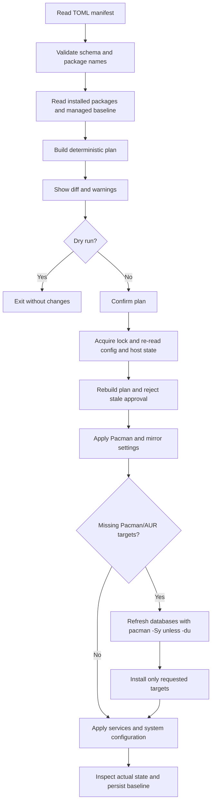

# Architecture

Zacman is a Linux system-management CLI organized around a small set of internal packages. The executable is built from the repository root; implementation packages stay under `internal/` so they are not exposed as public Go APIs.

## Components

| Package | Responsibility |
|---|---|
| `internal/cli` | Cobra command tree, command orchestration, confirmations, diff output, Pacman passthrough, and user-facing errors |
| `internal/config` | TOML parsing, strict schema validation, duplicate detection/repair, comment-preserving edits, and atomic manifest writes |
| `internal/planner` | Deterministic package reconciliation from desired config, installed state, and the last managed baseline |
| `internal/pacman` | Pacman queries and transactions, provider detection, native argument passthrough, and marker-managed Pacman/mirrorlist edits |
| `internal/pkgmanager` | Structured adapters and inventory parsing for Flatpak, uv, pip, npm, Cargo, and Go-installed tools |
| `internal/services` | Structured `systemctl` calls and enabled/disabled state inspection |
| `internal/state` | Versioned managed-package baseline stored under `/var/lib/zacman/state.json` |
| `internal/transaction` | Locking for Zacman state-changing operations |
| `internal/execx` | Shared subprocess execution and interrupt handling |

## Reconciliation flow

The diagram describes the normal `init` path. `init -du` skips the `pacman -Sy` refresh and uses existing local sync databases. `init -dfc` and `init -axp` are separate bootstrap/import paths and do not run package transactions. `update` is a separate command that performs the full `pacman -Syu` operation.

## State and ownership

- The TOML manifest is the desired configuration and remains human-editable.
- The state file records only the last successfully reconciled managed repository-package baseline. It is not a second desired-state source.
- The initial reconciliation is install/adopt-only because the program cannot infer ownership of every undeclared package on an existing machine.
- After a successful transaction, Zacman inspects actual installed state before saving the new baseline. Partial failures are reported; the next invocation replans from actual system state.
- Foreign packages imported by `init -axp` are retained as inventory and are not automatically assumed to be AUR packages.

## Transaction boundaries

Zacman locks its own state-changing operations and uses atomic replacement for individual configuration/state files. Pacman, systemd, locale generation, and desktop settings are external side effects; they cannot be wrapped in a single operating-system transaction. Zacman does not claim global rollback. The next plan is derived from the actual host state.

Pacman remains the authority for dependency resolution and package transactions. `systemctl` remains the authority for service operations. External package managers are called through structured argument arrays; values from TOML are not executed through a shell.
